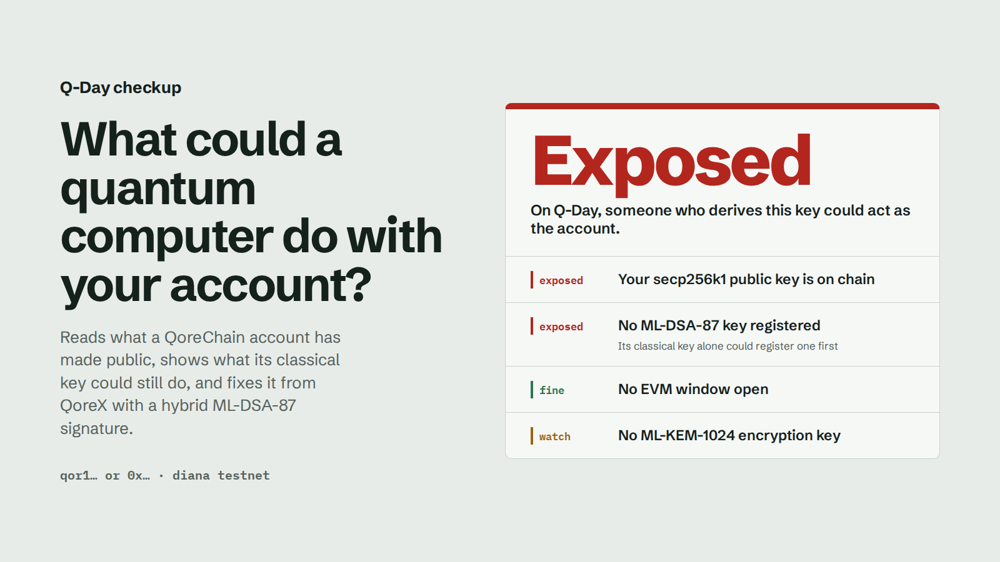

# Q-Day checkup



[](https://build.qorechain.io/p/q-day-checkup)

**What could a quantum computer do with your QoreChain account?** Paste a `qor1…` or `0x…` address, or check your
QoreX account, and see what the account has already made public on the diana testnet, what that would let a
quantum attacker do, and fix it from QoreX with a hybrid (secp256k1 + ML-DSA-87) signed transaction.

A Quantum Pass entry for Build Before Q-Day, built with `create-qorechain-dapp` (viem-wagmi template). A small
companion to [strongChar](https://github.com/rounak-agl/strongChar).

## What it checks

| Check | Read from | Why it matters on Q-Day |
|---|---|---|
| Is the secp256k1 public key on chain? | `cosmos/auth` account `pub_key`, EVM nonce | Shor's algorithm turns a public key into its private key. An address alone (a hash) is safe. |
| ML-DSA-87 key registered, possession proven? | `qorechain/pqc/v1/account` | diana requires hybrid signatures from registered accounts (`hybrid_signature_mode = required`). Until a key is registered, the classical key alone can register one, so a quantum attacker could claim the account first. |
| EVM authorisation window | `qorechain/pqc/v1/evm_window` via `evmWindowStatus` | EVM transactions carry secp256k1 signatures only. An open window lets that key alone spend up to the window's limits. Wide or long windows are flagged. |
| ML-KEM-1024 encryption key | `qorechain/pqc/v1/kem` | Without one, nothing can be sealed to the address with post-quantum encryption. |

The page also counts, live, how diana's latest 50 post-quantum key registrations were signed (`api/registrations.ts`, a
Vercel function cached for 5 minutes). On 22 Nov all 50 were accepted with a secp256k1 signature alone: an account's
first ML-DSA-87 key needs nothing more.

Measured on diana on 22 Nov before writing the copy: none of the last 500 successful `MsgSend` transactions was
signed classically only, and 49 of the last 50 PQC key registrations were.

## Fixes, signed by QoreX

QoreX signs every native-lane transaction with both keys and reports whether the committed transaction kept the
ML-DSA-87 layer; the page shows that result.

- **Close the EVM window** (`MsgCloseEVMWindow`).
- **Narrow it**: close and reopen in one transaction, for about an hour, one transaction, 2 QOR, one target.
- **Put the checkup on chain**: a 1 uqor transfer to yourself with the verdict and a report hash in the memo.
- **Register a post-quantum key**: only QoreX can send that message, so the page tells you to do it there.

## Run

```sh
pnpm install
pnpm dev            # http://localhost:5173
pnpm build
pnpm check:cases    # verdicts for stubbed chain states
pnpm check:qorex    # every fix against the QoreX test double (refused, so nothing is spent)
pnpm check:live qor1…   # the checkup against real diana accounts
pnpm smoke          # the app in a browser with the QoreX test double (SMOKE_URL for the live site)
```

Live: https://strongchar-qday.vercel.app. The film is built in `video/` (Remotion): `node video/scripts/record.mjs` records the
clips from a running dev server, `uv run python video/scripts/score.py` writes the score, `pnpm --dir video render` renders it.

The chain's REST API sends no CORS headers: the dev server proxies `/lcd-testnet` (`vite.config.ts`), and in
production `vercel.json` rewrites only the four read paths the page uses.

## Credits

- QoreChain kits: [`create-qorechain-dapp`](https://www.npmjs.com/package/create-qorechain-dapp) (scaffold),
  [`@qorechain/evm`](https://www.npmjs.com/package/@qorechain/evm) (chains, `evmWindowStatus`),
  [`@qorechain/qorex-rainbowkit`](https://www.npmjs.com/package/@qorechain/qorex-rainbowkit) (QoreX in RainbowKit),
  [`@qorechain/qorex-types`](https://www.npmjs.com/package/@qorechain/qorex-types) (QoreX native lane),
  [`@qorechain/sdk`](https://www.npmjs.com/package/@qorechain/sdk) (message builders, address conversion),
  [`@qorechain/qorex-wallet-mock`](https://www.npmjs.com/package/@qorechain/qorex-wallet-mock) (tests)
- [React](https://react.dev), [Vite](https://vite.dev), [wagmi](https://wagmi.sh), [viem](https://viem.sh),
  [RainbowKit](https://rainbowkit.com), [TanStack Query](https://tanstack.com/query), [tsx](https://tsx.is)
- Fonts: Schibsted Grotesk and IBM Plex Mono (Google Fonts; Fontsource in the film)
- Film: [Remotion](https://www.remotion.dev), [Playwright](https://playwright.dev) (recordings), [NumPy](https://numpy.org) (score)

AI use: see [AI_USAGE.md](AI_USAGE.md). Licence: MIT.
